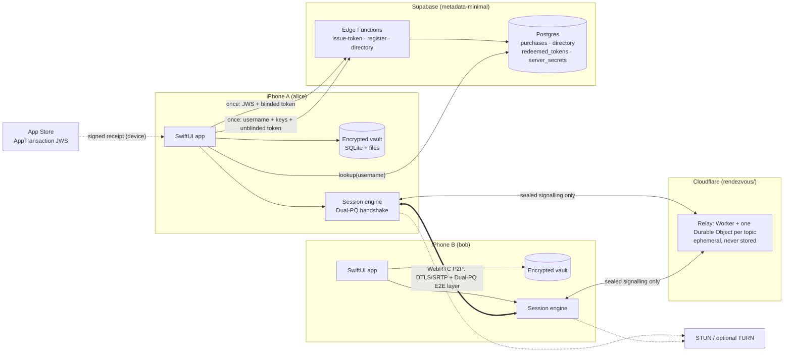

# Priva: System Design

Version 1.0 · iPhone-only · iOS 26+ · Swift 6 / SwiftUI

Priva is a paid, peer-to-peer, end-to-end encrypted messenger with voice and video calls.
Its core promise: **nobody except the two people talking can read, hear or see what they
exchange, and nobody (including us) can link an App Store purchase to a username.**

---

## 1. Requirements

| # | Requirement | How the design meets it |
|---|---|---|
| R1 | Paid app ($9.99/$10 tier). Paying unlocks one username | StoreKit 2 `AppTransaction` verified server-side, then an RFC 9474 blind token |
| R2 | After purchase verification, remove the App Store ↔ app link | JWS discarded; token unblinded client-side; StoreKit asked again only for the monthly relay-pass proof (also blind-signed) |
| R3 | Username + password + Face ID/Touch ID, all required to unlock | Vault key wrapped under `scrypt(password) ⊕ SecureEnclave(biometry)` |
| R4 | Search a username, send request, other side accepts | Exact-match directory lookup; PQ-sealed request over ephemeral broadcast |
| R5 | Messages, images, video, files, voice and video calls via WebRTC | WebRTC data channels + SRTP media, peer to peer |
| R6 | No content ever goes through Supabase | Supabase carries only sealed, padded signalling blobs, never stored |
| R7 | Offline recipient ⇒ message stays in the sender's queue | Encrypted outbox on the sender's device; retry until peer is online |
| R8 | Password reset | Change (with current password) or reset (with 24-word recovery phrase + Face ID) |
| R9 | Supabase keeps only: purchase IDs, active usernames | 2 data tables + 1 anti-double-spend set + server secrets. No IPs/devices/graph |
| R10 | No correlation purchase ↔ username | Blind signatures make it cryptographically unlinkable |
| R11 | "Dual PQC" for chat, files, voice, video | Two independent PQ KEMs (X-Wing & ML-KEM-1024) + two AEADs + two signatures |
| R12 | Fast, smooth, modern UI | SwiftUI + Liquid Glass (navigation layer only), 120 Hz-friendly lists, springs, haptics |

---

## 2. Threat model

| Adversary | Capabilities | Guarantee |
|---|---|---|
| **Server operator** (Supabase, Cloudflare / us), honest-but-curious or breached | Reads DB, edge logs, relay traffic | Sees no content, no social graph in DB, no purchase↔username link. Sees IPs & timing of connections (metadata) |
| **Network attacker**, incl. *harvest-now-decrypt-later* quantum | Records/modifies all traffic | Content confidential against quantum adversaries (ML-KEM-768 + ML-KEM-1024 + X25519) |
| **Active MITM on signalling** | Rewrites SDP / keys | All signalling is AEAD-authenticated with pair keys; DTLS fingerprints key-confirmed in-band; safety numbers + call SAS emoji |
| **Stranger / spammer** | Knows your username | Can send friend requests only; cannot message you until you accept |
| **Malicious friend** | Talks to you | Learns your IP in direct mode → "Relay calls" (TURN) hides it |
| **Device thief** | Holds locked/unlocked phone | Needs password **and** your face/finger; data is `NSFileProtectionComplete` + app-layer AES-256 |
| **Apple** | Knows who bought Priva | Cannot see usernames or content (Apple is outside our control for purchase identity) |

Out of scope: compromised iOS kernel / jailbreak with root; global passive adversary doing
traffic-correlation across the internet; malicious app update (mitigate by reproducible builds).

---

## 3. Architecture overview



**Three planes:**
1. **Account plane** (Supabase Edge Functions, used ~twice per account lifetime): purchase → token → username.
2. **Rendezvous plane** (Priva's own relay on Cloudflare, `rendezvous/`): tiny sealed envelopes that let two online friends find each other and exchange WebRTC offers. Nothing is persisted; if nobody is listening the envelope vanishes. Only buyers get in (daily blind-signed passes) and only a topic's owner can listen.
3. **Data plane** (WebRTC peer-to-peer): all messages, media, files, audio, video. Never touches Supabase.

---

## 4. What Supabase stores (exhaustive)

```sql
purchases        (purchase_ref text PK,        -- HMAC-SHA256(pepper, appTransactionID)
                  environment  text,            -- Production | Sandbox | Dev
                  verified_on  date,            -- day granularity only
                  tokens_issued smallint,       -- ≤ 2
                  issued_blinded_sha256 text[]) -- idempotent re-issue; blinded ⇒ unlinkable
directory        (username text PK,             -- normalized [a-z0-9_]{3,20}
                  bundle   bytea,               -- public keys + self-signatures (~8.6 KB)
                  created_on date, updated_on date)
redeemed_tokens  (token_sha256 text PK, redeemed_on date)  -- double-spend prevention
server_secrets   (name text PK, value bytea)    -- HMAC pepper, blind-signing key (service_role only)
app_config       (key text PK, value jsonb)     -- e.g. allow_dev_purchases (false in prod)
```

* No IP addresses, device IDs, emails, phone numbers, push tokens, contact lists, friend
  relationships, message metadata or timestamps finer than a day.
* `purchases` is the **list of people who bought the app**, but it contains only a keyed hash
  of Apple's per-account `appTransactionID`. There is no column, key, or timestamp that joins it
  to `directory`.
* `redeemed_tokens` stores `SHA-256(token)`; thanks to blinding, the server never saw `token`
  at issuance time, so it cannot link it back to a purchase.
* All tables: RLS **enabled with zero policies**, and `anon`/`authenticated` privileges revoked.
  The only anonymous entry points are the edge functions and one `SECURITY DEFINER` RPC,
  `lookup_username(text)`, which does exact-match lookup (no prefix search, no listing).

---

## 5. Purchase → username, without linkability

```mermaid
sequenceDiagram
  participant App
  participant Apple as App Store
  participant IT as issue-token (Edge)
  participant RG as register (Edge)
  App->>Apple: AppTransaction.shared (StoreKit 2)
  Apple-->>App: JWS (ES256, x5c → Apple Root CA G3)
  App->>App: T = "PRIVA-TOKEN-v1" ‖ 32 random bytes<br/>(blinded, r⁻¹) = Blind(pk_pinned, T)
  App->>IT: { jws, blinded }
  IT->>IT: verify chain to pinned Apple Root G3, ES256 sig,<br/>bundleId, environment → ref = HMAC(pepper, appTransactionID)
  IT->>IT: tokens_issued < 2 ?  s' = BlindSign(sk, blinded)
  IT-->>App: s'
  App->>App: σ = Finalize(s', r⁻¹); verify σ with pinned pk (anti key-tagging)<br/>erase JWS; never call StoreKit again
  Note over App: user picks username, password, Face ID,<br/>writes recovery phrase (minutes pass)
  App->>RG: fresh TLS connection: { username, bundle, T, σ }
  RG->>RG: RSA-PSS verify σ over T · insert SHA-256(T) into redeemed_tokens<br/>verify bundle self-signatures (Ed25519 + ML-DSA-65) · insert directory
  RG-->>App: ok
  App->>App: erase T, σ
```

* **Blind signature scheme:** RSABSSA-SHA384-PSS-Deterministic (RFC 9474), 4096-bit key.
  `T` is 32 bytes of CSPRNG output, so the deterministic variant is safe (RFC 9474 §7.3).
* **Why this is unlinkable:** the server sees `blinded = H(T)·rᵉ mod n` with uniformly random `r`.
  Given `(T, σ)` later, every past `blinded` value is equally likely → information-theoretic
  unlinkability, even against a quantum computer.
* **Key-tagging defence:** the app ships with the signing public key pinned (SHA-256 of DER).
  A server trying to tag users with per-user keys would produce signatures that fail local verification.
* **Idempotency:** the client persists `(T, r⁻¹)` in the Keychain before calling `issue-token`,
  so a retry re-sends the same `blinded` and receives the same signature (does not burn a token).
* **Residual risk (honest):** Supabase platform logs (IP, precise time) exist outside our schema.
  An adversary with those logs could try timing correlation. Mitigations: day-granular DB
  timestamps, separate TLS sessions, human-scale delay between the two calls. For maximum
  anonymity, users can register over a VPN/Tor.

---

## 6. Cryptographic design ("Dual-PQ")

### 6.1 Primitives (all Apple CryptoKit, hardware-accelerated where available)

| Role | Layer 1 | Layer 2 | Breaks only if… |
|---|---|---|---|
| Key encapsulation | **X-Wing** (ML-KEM-768 + X25519) | **ML-KEM-1024** | X25519 **and** ML-KEM-768 **and** ML-KEM-1024 all break |
| Signatures (identity) | **Ed25519** | **ML-DSA-65** | both forged |
| AEAD | **AES-256-GCM** (inner) | **ChaCha20-Poly1305** (outer) | both broken |
| KDF | HKDF-SHA-512 | | |
| Password | scrypt (N=2¹⁵, r=8, p=1) | + Secure Enclave P-256 ECDH gated by biometry | both |

"Dual PQC" therefore means two independent post-quantum KEMs (two ML-KEM parameter sets,
one also hybridised with X25519) combined through a transcript-bound KDF, plus a
double AEAD cascade with independent keys, plus AND-composed hybrid signatures.

### 6.2 Identity (recoverable)
A 32-byte **master seed** `S` is generated on-device and shown once as a 24-word BIP-39
phrase. Every identity key is derived deterministically:

```
k_label = HKDF-SHA512(ikm: S, salt: "priva.identity.v1", info: label)
Ed25519      ← k("ed25519")       (32 B)
ML-DSA-65    ← k("mldsa65")       (32 B seed, FIPS 204 ξ)
X-Wing       ← k("xwing")         (32 B seed)
ML-KEM-1024  ← k("mlkem1024")     (64 B seed d‖z)
inboxSecret  ← k("inbox")         (32 B)
```

Public **bundle** = `{v, username, ed25519_pk, mldsa65_pk, xwing_pk, mlkem1024_pk}` signed
by both identity keys. Restoring on a new phone = typing the phrase → same keys → same username.

### 6.3 DualSeal: one-shot public-key encryption (friend request / accept)
```
(ss1, ct1) = XWing.Encaps(pkX)        (ss2, ct2) = MLKEM1024.Encaps(pkK)
th  = SHA-512("PRIVA-DUALSEAL-v1" ‖ aad ‖ pkX ‖ pkK ‖ ct1 ‖ ct2)
okm = HKDF-SHA512(ikm: ss1‖ss2, salt: th, info: "priva/dualseal/keys", 96 B)
c   = ChaChaPoly(k2, AES-GCM(k1, pt, aad: th), aad: th)
out = 0x44 ‖ ct1 ‖ ct2 ‖ c           exporter = okm[64..96]
```

### 6.4 Friendship establishment (mutual, PQ, authenticated)
1. **A → B** on B's *request topic* `r.<b32(SHA-256("priva/req/v1"‖B.ed‖B.mldsa))>`:
   `DualSeal(B, {from: alice, bundleA, inboxSecretA, note, rid, ts} ‖ HybridSig_A(th ‖ fields))`.
2. B decrypts, verifies both signatures, **and** re-fetches `alice` from the directory to
   confirm the bundle matches (no name spoofing). Shows the request.
3. **B → A** on A's inbox: `DualSeal(A, {from: bob, rid, inboxSecretB, ts} ‖ HybridSig_B(th₂ ‖ th₁))`.
4. Both derive the **pair root key**
   `PRK = HKDF-SHA512(ikm: exp₁ ‖ exp₂, salt: SHA-512(th₁‖th₂), info: "priva/pair/v1" ‖ sorted(names))`:
four PQ encapsulations (2 × X-Wing, 2 × ML-KEM-1024) from both directions.
5. A confirms receipt; both sides show the **safety number** (60 digits + QR) for optional
   in-person verification. Unverified contacts show a gentle "Verify" chip (usability research
   shows verification must be in-flow to be used).

### 6.5 Session handshake (every connection; forward secret; deniable)
Runs over the rendezvous plane, sealed with pair keys `K_sig = HKDF(PRK, "sig" ‖ dir)`:

Three trips when both phones support it (`early` in the hello), four with older builds:

```
A → B  HELLO    { sid, ephX_A, ephK_A, intent, early }                (sealed with K_sig A→B)
B → A  HELLO_ACK{ sid, ctX_A, ctK_A, ephX_B, ephK_B, SDP(offer)_EK }  (encaps to A's ephemerals)
A → B  FINISH   { sid, ctX_B, ctK_B, SDP(answer)_SK }                 ·  ICE { candidates } as found
EK  = HKDF-SHA512(ikm: PRK ‖ ss1, salt: SHA-512(hello ‖ ack), "priva/session/early-sdp")
SK  = HKDF-SHA512(ikm: PRK ‖ ss1 ‖ ss2, salt: SHA-512(transcript), "priva/session/master")

older peer:  HELLO → HELLO_ACK → OFFER { sid, ctX_B, ctK_B, SDP(offer)_SK } → ANSWER { sid, SDP(answer)_SK }
```

* The early key `EK` needs the pair root and A's fresh ephemeral: only the friend can make B's offer, it is
  forward secret, bound to this hello and ack, and a replayed ack opens nothing. Candidates B finds after its ack
  (before `SK` exists) travel under `EK` with their own label. Saves one trip through the server (≈ 1 RTT to the
  Supabase region) and one metered signal per connection.

* Four fresh PQ encapsulations per session → **forward secrecy** even against quantum.
* Authentication is symmetric (PRK) → **deniable** (no signature proves you talked).
* **Key confirmation:** first data-channel frame is `HMAC(SK, "fp" ‖ localDTLSfp ‖ remoteDTLSfp)`;
  mismatch ⇒ abort (detects anyone splicing DTLS).
* **Post-compromise healing:** after a confirmed session both set
  `PRK ← HKDF(PRK, SK_ratchet, "priva/pair-ratchet")` (previous PRK kept one generation for resync).
* Replay protection: ±120 s timestamp window + nonce cache; envelopes padded to size buckets
  (2 KiB steps up to 8 KiB, then to 64 KiB) so the server cannot tell message types apart.

### 6.6 Session keys
`SK` expands into: data-channel keys (per direction, per channel; AES-256 + ChaCha20 keys),
media keys (per direction), signalling keys, confirmation key, 4-emoji **SAS** for calls, and
the PRK ratchet secret.

* **Data frames:** `type ‖ counter(8) ‖ ChaChaPoly(AES-GCM(pt))`, nonces derived from the
  strictly-increasing counter; receiver rejects any non-sequential counter.
* **Media (voice/video):** WebRTC encoded-frame encryption (`LKRTCFrameCryptor`, AES-GCM)
  keyed from `SK` via HKDF, installed **before** the first frame (`discardFrameWhenCryptorNotReady`).
  Frames are therefore encrypted with PQ-derived keys *inside* SRTP.

### 6.7 Files, images, videos
* Before sending, media is stripped of metadata (EXIF/GPS/QuickTime location) and, if the
  user chooses "Optimized", re-encoded (HEIC / HEVC 1080p) on the Media Engine.
* Each file gets a random 256-bit content key; encrypted as 64 KiB AES-256-GCM chunks
  (`nonce = fileSalt ‖ chunkIndex`, AAD binds header, index, and last-chunk flag → no truncation/reorder).
* The **same ciphertext** is stored on both phones; the content key travels inside the message.
  Transport adds the session Dual-AEAD layer and DTLS.
* Transfers stream from disk with back-pressure (`bufferedAmount` high/low watermarks),
  resume from the last acknowledged chunk after a reconnect.

---

## 7. Device security (at rest & in use)

```
VK (vault key, 256-bit random) ── encrypts ──► SQLite field blobs, file content keys, seed S
KEK = HKDF(scrypt(password, salt) ‖ ECDH(SecureEnclaveKey[biometryCurrentSet], P))
wrap₁ = AES-GCM(KEK, VK)                 → unlock needs password AND face/finger
wrap₂ = AES-GCM(HKDF(S,"recovery"), VK)  → reset password with phrase (+ Face ID)
```

* Secure Enclave key: `.privateKeyUsage + .biometryCurrentSet`, `WhenPasscodeSetThisDeviceOnly`.
  Adding a new face/finger invalidates it (attacker can't enrol their own face) → phrase reset.
* Files: `NSFileProtectionComplete`, excluded from backups; SQLite with `secure_delete=ON`;
  usernames stored as `HMAC(VK, name)` keys; all rows are AES-GCM blobs.
* Auto-lock on background (configurable), app-switcher privacy cover, screen-capture
  protection for message content, blur on recording, clipboard expiry, third-party keyboards
  blocked, failed-attempt back-off with optional wipe after 10 failures, panic wipe.
* No analytics, no crash reporters, no third-party SDKs except WebRTC and swift-crypto.
* Integrity: jailbreak/debugger/injection heuristics → warning banner.

---

## 8. Rendezvous plane (Cloudflare relay, `rendezvous/`)

| Topic | Derivation | Who knows it | Carries |
|---|---|---|---|
| Request `r.*` | SHA-256 of public keys | anyone with the directory entry | DualSealed friend requests |
| Inbox `i.*` | HKDF(inboxSecret) | your friends only | sealed session signalling, acceptances |

* Receive: one WebSocket per own topic (`wss://<PRIVA_RELAY_HOST>/connect?topic=…`). Each topic is a
  Durable Object that hibernates between signals; the relay answers `ping` itself (`setWebSocketAutoResponse`), so
  idle sockets cost nothing. Server→client frames are `[event length][event][payload]`.
* Send: `POST /send` with `{"messages":[{topic, event, d}]}` (≤ 64 per request, ≤ 96 KiB each) → 202. Fire-and-forget;
  the relay keeps nothing.
* **Only buyers:** every connect and send carries `Authorization: Pass <token ‖ sig>`, today's relay pass. Passes are
  RFC 9474 blind RSA signatures (`relay_sk_v1`, 2048-bit, pinned key id in the app) from the `relay-pass` function,
  35 at a time (one per day), at most 160 a month per purchase (`purchases.relay_passes`). The token holds the day;
  the relay accepts today ± 1. The server never sees a token unblinded, so passes can't be linked to a purchase or to
  each other. Development passes follow `allow_dev_purchases`.
* **Only the owner listens:** `X-Priva-Listen: <Ed25519 pub>.<ts>.<sig over "priva-listen-v1|topic|ts">` (± 300 s).
  The first key to listen owns the topic (stored in the topic's Durable Object); any other key gets 403. Keys are
  derived per topic (`ListenKey`): from the identity seed for your own inbox/request topics, from the friend's
  announce key for their announcement topic: the relay can't link one phone's topics by key.
* Rate limits per IP (send 600/min, connect 300/min) and per pass (300/min).
* Receivers trial-decrypt against each friend's key (no plaintext sender tags).
* Transport: TLS 1.3 minimum; iOS 26 negotiates hybrid PQ TLS (X25519MLKEM768) with Cloudflare-fronted endpoints.

### Delivery & the sender-side queue
* Every outgoing item (message, file, friend request, acceptance) lives in the **sender's encrypted outbox**.
* While the app is active: on unlock the app announces itself to friends; for any friend with
  pending items it sends `HELLO` with jittered back-off (6 s → 5 min). When the peer answers,
  a session forms and the outbox flushes; items are deleted from the sender only after an
  end-to-end `ack`.
* **Platform limit (honest):** iOS suspends apps in the background. With nothing stored on the
  server, delivery happens when both devices have Priva open at the same time. The optional
  *privacy-preserving wake relay* (§12) removes this limit without storing messages.

---

## 9. Calls

* One `RTCPeerConnection` per friend session carries data channels plus audio/video transceivers
  added on demand; renegotiation happens **over the encrypted data channel** (no server round-trip).
* Ringing starts in parallel with ICE, so accepting a call is near-instant.
* Audio: Opus 48 kHz, in-band FEC, DTX, hardware AEC (VPIO). Video: 720p30 H.264 (VideoToolbox
  hardware), VP8 fallback, `balanced` degradation under congestion, 2.5 Mbps cap. Not yet: ICE restart on a network
  change (a Wi-Fi ↔ cellular switch ends the call; audit STA-24).
* No CallKit yet: calls ring inside Priva while it's open.
* In-call: 4-emoji SAS for MITM check, live quality indicator, draggable PiP self-view.
* Optional **Relay calls** (TURN) hides IP addresses from the peer.

---

## 10. UI / UX design

**Principles (from research):**
1. *Liquid Glass belongs to the navigation layer only* (tab bar, toolbars, composer, call controls). Content (bubbles, lists) stays solid for legibility.
2. *Status removes anxiety*: every message shows a precise state, **Queued on this iPhone** (clock), **Delivered** (✓✓), **Failed** (retry). Tapping "Queued" explains the P2P model in one sentence.
3. *Security must be visible but effortless*: persistent "Dual-PQ encrypted" chip, in-flow verification (safety numbers usability studies show out-of-flow ceremonies are ignored), SAS on calls.
4. *One task per onboarding screen*, explain *why* (Face ID + password), force recovery-phrase confirmation (users skip backups otherwise).
5. *Motion with meaning*: spring physics, matched-geometry send animation, haptics on send/receive/connect; everything honours Reduce Motion, Reduce Transparency, Dynamic Type, VoiceOver.

**Brand:** "Aurora" gradient (violet `#6C5CFF` → cyan `#3EC6FF`) on midnight (`#07080D`); mint `#3DDC97` for secure states. SF Pro, SF Mono for keys and phrases.
**Logo:** a geometric "P" whose bowl is a keyhole, privacy you can hold.

**Screens:** Welcome → Purchase check → Username → Password → Face ID → Recovery phrase (show + verify) → Key generation → Home (Chats · Friends · Calls · Settings, + Find tab) → Chat → Call → Contact/Safety number → Settings.

---

## 11. Performance targets & how we measure

| Metric | Target | Measured by |
|---|---|---|
| Unlock (Face ID → password → home) | < 700 ms | signposts |
| Session setup, both online | < 1.5 s | handshake timestamps |
| Message round-trip (send→ack) | < 150 ms LAN | in-app diagnostics |
| File transfer throughput | ≥ 20 MB/s LAN | 250 MB transfer between 2 simulators |
| Video | 720p @ 30 fps, 0 decrypt failures | `RTCStatsReport` |
| Chat scroll | 120 Hz, no hitches with 10k msgs | paged loading, instruments |
| DualSeal / handshake CPU | < 2 ms / < 10 ms | XCTest `measure` |

---

## 12. Optional: privacy-preserving wake relay (off by default, needs APNs key)
To deliver when the recipient's app is closed, without storing messages:
a device registers an APNs token under a random `mailbox_id` (never linked to username),
and shares `mailbox_id` only with friends inside the encrypted channel. A friend with a queued
message calls `wake(mailbox_id)`; the server sends a content-free push (or a VoIP push for calls).
The server learns only "someone woke mailbox X". This adds one table and is left for the owner
to enable, because the brief limits Supabase to purchases and usernames.

---

## 13. Security test plan
* Unit: KEM/AEAD/signature round-trips, tamper/replay/wrong-key rejection, recovery phrase checksum, file chunk reorder/truncation, cross-implementation ML-DSA verification (CryptoKit ↔ server).
* Server: anon cannot read/write any table; lookup is exact-only; forged/double-spent tokens rejected; forged Apple JWS rejected; bundle signature enforcement; injection & oversize inputs.
* Client: grep the simulator container for plaintext; Keychain attributes; ATS; no secrets in logs; snapshot/capture protection.
* Traffic: capture relay payloads, confirm only padded ciphertext (WireSecurityTests); attack the relay without a pass, with forged/other-day/tampered passes, and as a non-owner listener (RelaySecurityTests).
* Supabase security & performance advisors.
