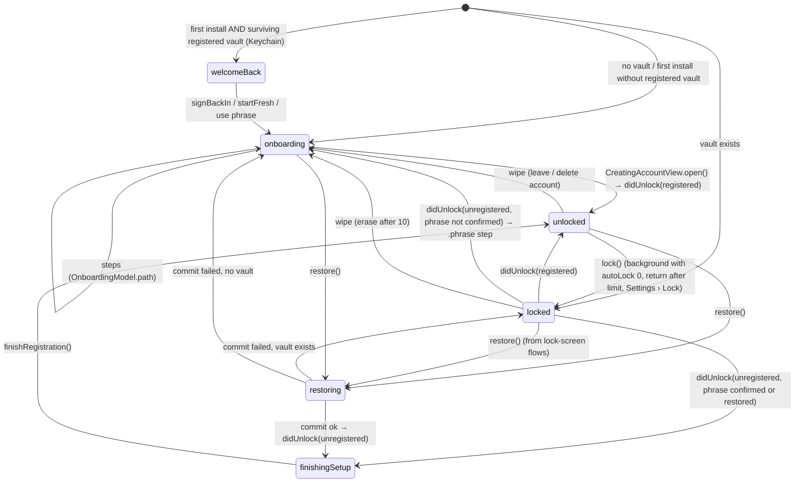
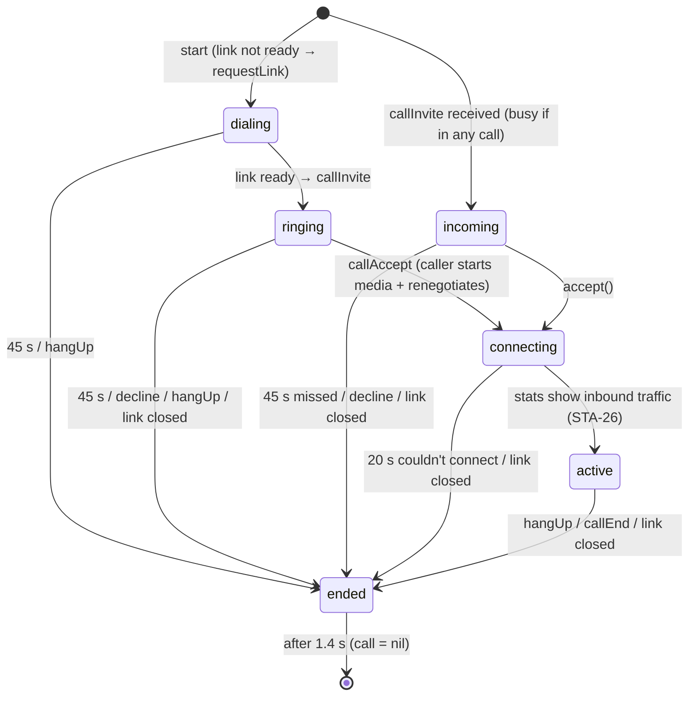
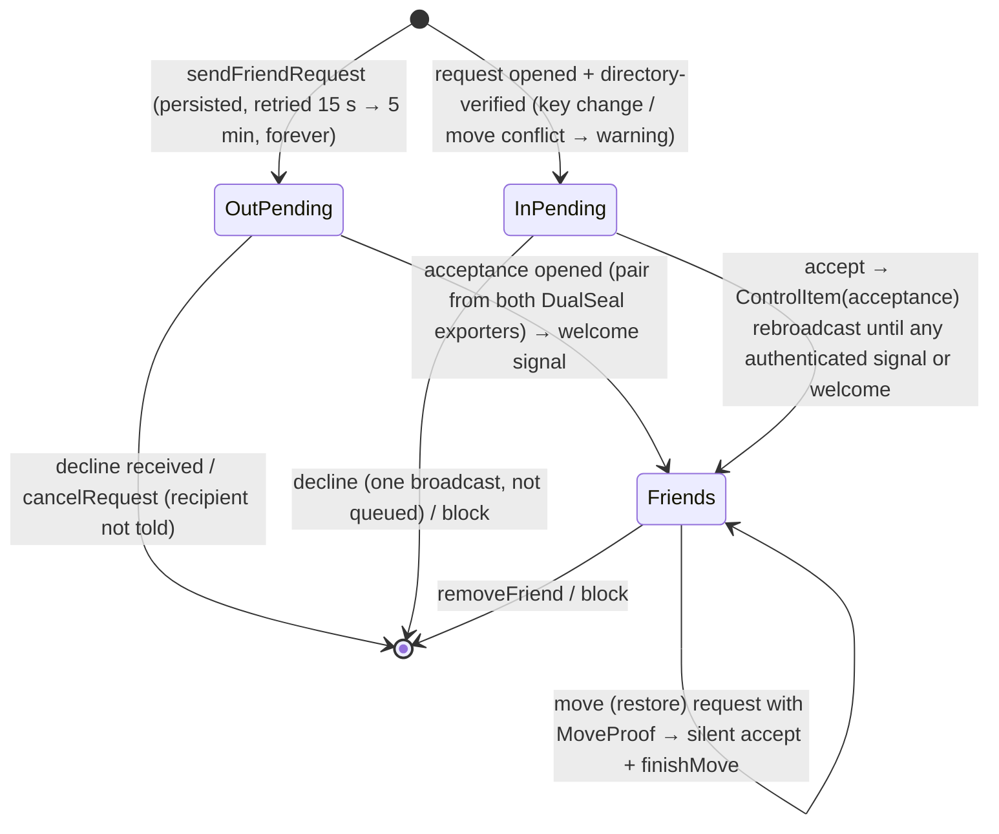

# Priva: system overview (as built, October 2026)

This document is reconstructed from the source, not from the design docs. Where the two disagree, the code wins and
the gap is noted. Findings referenced as STA-nn are in `state-and-correctness.md`.

## 1. Components and responsibilities

| Layer | Type (file) | Responsibility |
|---|---|---|
| App | `AppModel` (`App/AppModel.swift`) | App phase machine (`onboarding / welcomeBack / locked / finishingSetup / unlocked / restoring`). Owns the `PrivaEngine` while unlocked. Handles auto-lock on scene changes, the privacy and capture cover windows, restore orchestration, and wipe. |
| App | `OnboardingModel` | Sign-up, sign-back-in and restore-finishing steps: purchase → password → Face ID (vault created) → recovery phrase → register username → build migration. |
| App | `PrivaApp` / `RootView` / `AppDelegate` | Switches screens by phase. Raises the file-descriptor limit. Blocks third-party keyboards. |
| App | `DebugAutomation` | DEBUG-only launch switches (reset, autofill, key-factor import/export). |
| Engine | `PrivaEngine` (`Core/Engine/PrivaEngine.swift`, 1,785 lines) | The unlocked node. Contacts, requests, summaries and threads (UI state). The 1.5 s scheduler `tick`. Peer links (`[String: PeerLink]`). Signalling in and out. Friend-request protocol. Presence. Rename and move (restore) handling. Blocking. Disappearing messages. Files (sender and receiver bookkeeping). Batched arrivals. Group-media retention. Directory lease and sweep. Migration duties. The delegate for every `PeerLink`. |
| Engine | `CallCenter` | 1:1 call phases. Rides on the friend's `PeerLink` (media added by renegotiating over the data channel). |
| Engine | `FriendProtocol` | Sealed and signed friend request and acceptance (DualSeal plus hybrid signatures). |
| Engine | `TransferRegistry` / `FileSender` | Receive side: writes chunks off the main thread. Send side: streams chunks with back-pressure. |
| P2P | `PeerLink` | One WebRTC session per friend. Three-trip (or legacy four-trip) PQ handshake over the relay. Key confirmation over DTLS fingerprints. `FrameCipher` control channel "c". `BulkChannel` "f" for file chunks. Media plus frame encryption. Renegotiation. Group media forwarding. |
| P2P | `Wire` / `Signal` / `SDPUtil` / `ServerClock` | Wire formats: binary-plist signals, JSON data-channel messages. SDP helpers. Server-corrected clock. |
| P2P | `WebRTCEnv` / `ManagedRelay` | Peer-connection factory and configuration. Audio-session ownership. TURN credentials. |
| Groups | `GroupHub` | Host side: rules, sequencing, storage, fan-out, per-member durable queue, admin actions, roster publishing, successor links, handover and failover. Member side: post, receive, ack, sync. |
| Groups | `GroupCallCenter` / `GroupLocalMedia` | Star-topology group calls. The host decrypts and re-encodes each member's media for the others. |
| Storage | `Store` / `SQLiteDB` | One SQLite file (WAL). Every row is AES-GCM with AAD = table‖id. Names are stored as HMAC keys. Plaintext index columns (`pending`, `unread`, `expires`, `media`). Media files are `.pfe` (FileCipher). |
| Backup | `BackupCenter` / `BackupExporter` / `BackupImporter` / `BackupRestore` | Encrypted backups (Backup Key, password and iCloud Keychain factor). Restore in two steps: stage into `Restore-*`, then commit (directory swap with a Keychain journal). |
| Security | `Vault` / `BiometricGate` / `Keychain` | Vault key wrapped under scrypt(password) ⊕ Secure-Enclave ECDH. Recovery wrap. Lockout and erase-after-10. Revocation record. |
| Network | `PrivaAPI` | Supabase edge functions: issue-token, register, directory (renew / retire / revoke), lookup RPC, relay-pass, turn. Plus relay `POST /send`. |
| Network | `RealtimeClient` | One WebSocket per listened topic to the Cloudflare relay, each authenticated by a relay pass plus a per-topic listen key. Heartbeat, path monitor, backoff. |
| Network | `RelayPass` / `TorService` / `NetworkPrivacy` | Daily blind-signed passes. Embedded Tor. Proxy routing that fails closed. |
| Purchase | `PurchaseService` | StoreKit `AppTransaction` → blind token (RFC 9474). DEBUG dev nonce. |
| Media | `MediaPrep` / `MediaVault` / `SafeImage` / `MediaSaver` | Metadata stripping and re-encode. In-memory decrypted caches. Streaming encrypted playback. |
| Features | SwiftUI screens | Onboarding, Lock, Main (tabs), Chat, Groups, Calls, Friends, Settings, Backup, Safety. |
| Servers | `supabase/functions/*`, `rendezvous/` (Cloudflare Worker + Durable Object per topic) | Account plane and rendezvous plane. No content ever reaches them. |

External dependencies:
- LiveKitWebRTC (pod).
- Tor.framework (C tor 0.4.9).
- swift-crypto / CryptoExtras (scrypt).
- Apple CryptoKit (ML-KEM, X-Wing, ML-DSA, AES-GCM, ChaChaPoly).
- StoreKit 2.
- Supabase (Postgres + edge functions).
- Cloudflare Workers + Durable Objects (relay).
- Cloudflare STUN and optional TURN.
- iCloud Drive and iCloud Keychain (backups).

## 2. Main state machines

### 2.1 App phase (`AppModel.phase`)



Rules that cut across all phases:
- `lockEpoch` is bumped on returning from the background while on the lock or welcome-back screen, which invalidates
  a Face ID approval given earlier.
- The privacy cover is shown on `.inactive` and `.background`.
- Auto-lock is skipped only for **1:1** calls (STA-03).

Combined-state gaps:
- Locking during a group call (STA-03).
- A `Store` that fails to open leaves the lock screen spinning (STA-15).
- Welcome back can't tell "wiped" from a wrong password (STA-16).

### 2.2 Onboarding (`OnboardingModel`)

| Step | Persisted effect | Survives a kill? |
|---|---|---|
| purchase | Blind token in the Keychain (`purchase.token`) | Yes (idempotent re-issue) |
| password | Nothing (password held in memory) | No; restarts at Welcome |
| biometrics | `Vault.create`: `vault.meta` (unregistered) and the SE key; `phraseConfirmed = false` | Yes; relaunch → locked → unlock → phrase step |
| phrase | `phraseConfirmed = true` (Keychain flag) | Yes |
| creating | Server registration → `Vault.markRegistered` → migration built in memory → revocation record overwritten → token purged | Partly; the migration is lost if killed before "Open Priva" (STA-14) |

### 2.3 Lock screen (`LockView`)

`biometric → password → unlocking → (success: didUnlock | failure: password / biometric)`.
- A Face ID approval older than 5 minutes is renewed before the password is checked.
- An `.invalidated` result with an older approval: ask for Face ID again and retry once.
- Wrong password → `FailureState.count+1`. From 5 failures the lockout is 30·2^(n−5) seconds, at most 1 hour. At 10,
  with erase on, everything is wiped.

### 2.4 PeerLink

```mermaid
stateDiagram-v2
  [*] --> handshaking: init (initiator: hello; responder: ack [+ early offer])
  handshaking --> connecting: installKeys (ack / offer / finish processed)
  connecting --> ready: confirm sent AND remote confirm verified
  handshaking --> closed: timeout 10 s / bye / auth failure / superseded / glare loser
  connecting --> closed: timeout 20 s / ICE failed / auth failure
  ready --> closed: idle 5 min (15 in onion) / ICE disconnected 4 s / data channel closed / send refused / bye / superseded / makeRoom / engine.stop
  closed --> [*]
```



- Glare: the smaller username keeps the initiator role while its hello is less than 1.5 s old.
- A `presence` signal from the peer kills our own handshake if it is older than 1.5 s, then redials.
- After every ready session the pair root ratchets forward (one previous root is kept).
- No ICE restart (STA-24). Bulk traffic doesn't count as activity (STA-09).

### 2.5 1:1 call (`CallCenter.Phase`)



### 2.6 Group call (`GroupCallCenter.Phase`)

- **Host:**
  - The host starts a call: `active`, and members are rung (offline members go into `unrung`).
  - A member asks for a call: the host goes to `incoming` (30 s), then `accept → beginHosting`.
  - Members join with `callJoin → hostJoin` (media plus forwarding).
  - When the host is alone for 60 s, the call ends.
- **Member:**
  - `requesting` (30 s timeout) or `incoming` (45 s), then `active` (on `callJoin`).
  - A host link drop or `callEnd` moves to `ended`.
- One call at a time across 1:1 and group calls, enforced in both directions.

### 2.7 Friend request lifecycle



### 2.8 Group lifecycle

```mermaid
stateDiagram-v2
  [*] --> Invited: host sends invite (durable); member keeps it in memory (STA-01)
  Invited --> Joined: member respond(accept) saves the group, host checks pendingInvites (memory, STA-01) → member added → publish
  Joined --> Joined: state / post / posted / deliver / ack / admin / deleted / link / sync
  Joined --> Joined: handover (planned, signed by host) / failover claim (successor, members verify)
  Joined --> Ended: removed / left / disbanded
  Ended --> [*]: forget (deletes only the newest 400 messages, STA-25)
```

### 2.9 Transfer lifecycle

- **Sender:**
  1. Encrypt to `media/<id>.pfe`.
  2. Message persisted, with `outgoingFiles[id]` (persisted).
  3. Peer asks with `fileWant`; chunks are streamed.
  4. `fileDone` → progress 1, entry removed.
- **Receiver:**
  1. The message arrives and is saved (`beginIncoming`).
  2. `incomingFiles` is persisted and a `Writer` is opened; `fileWant` lists every chunk.
  3. Chunks are written on the bulk thread; progress is reported every 0.1 s.
  4. Complete → `fileDone`, and `groups.fileCompleted` (host fan-out).
- **After a restart:** `resumeIncomingTransfers` re-checks the chunks on disk off the main thread, then sends
  `fileWant` for the missing ones when the link is ready.
- **Gaps:** there is no abandon or timeout (STA-09).

### 2.10 Backup and restore

- **Backup setup:** `prepare` (key, salt, public key; nothing saved) → the user confirms the key → `activate`
  (config saved).
- **Daily backup:** on the hourly tick, while connected and unlocked (STA-06 note: needs a connection).
- **Restore:**
  1. `unlock` (throttled) → `stage`: decrypt and import into `Restore-<uuid>` under a new vault key, and write
     `restore.previous`.
  2. Face ID, then `AppModel.restore`:
     - token check;
     - engine stopped;
     - `commit`: journal → move live → `Restore-old`, staged → live, `Vault.create` (new seed, new username, the
       backup's password);
     - journal deleted.
  3. `didUnlock` → `finishingSetup` → register the new username → first connected tick: `reconnectAfterRestore`
     (move proofs to every friend), then the old seed is deleted.
- **Recovery at launch:** `recoverInterruptedCommit` uses the journal to finish or undo an interrupted commit.

## 3. Data flows

**Sign-up:**
1. StoreKit `AppTransaction` (release) or dev nonce.
2. `issue-token` (blinded) → unblinded token stored in the Keychain.
3. Password.
4. Face ID → `Vault.create` (scrypt plus SE ECDH, off the main thread).
5. Recovery phrase shown, checked or saved as a key file.
6. `register` (fresh URLSession: ucommit, bundle, token, revoke hash).
7. `markRegistered`, revocation record stored, token purged.
8. `didUnlock` → `engine.start()`.

**Unlock:**
1. Face ID → password.
2. `Vault.unlock` (detached).
3. `didUnlock` → `Store(vaultKey:)` (main thread; one-time v3 migration) → `PrivaEngine` → `start()`:
   - `reload`, groups and backup load;
   - realtime connect (inbox and request topics);
   - inbox join → presence to ≤ 60 recent friends → tick every 1.5 s.

**Send / receive a message:**
1. `send` → `persist` (status queued, `pending = 1`).
2. If a link is ready: `.message` on the encrypted control channel. Otherwise the scheduler sends `hello`, then the
   handshake (3 relay trips), then ICE/DTLS, then confirm, then ready, then the pending messages flush.
3. Receiver: `.message` → validate → dedupe by id → batched `importMessages` (one transaction per main-queue
   drain) → `.ack` (and `.read` if read receipts are on).
4. Sender: `markOutgoing` → `delivered`/`read`.
5. Resend sweep: unacked messages older than 30 s go again on links that have been up more than 60 s.

**Friend request:** see 2.7.
- The request topic is `scrypt(username)`.
- The receiver verifies the bundle against the directory (`lookup(commit)`).
- Acceptance goes to the requester's inbox as a `ControlItem`, re-broadcast with backoff.
- The pair root comes from both DualSeal exporters.

**Group post:**
1. Member: `persist` → `.post` to the host (resent oldest first; slowed down by a token bucket).
2. Host: rules and keyword filter → `seq++` → `persist` → `enqueueGroup` per member → `.deliver` to online members.
3. Member: `.deliver` → `persist` → `.ack` → host dequeues. `posted(seq)` goes back to the author.
4. Attachments: the host acknowledges after the upload; fan-out happens on `fileCompleted` (STA-02).

**1:1 call:**
1. `callInvite` over the data channel.
2. The callee accepts (`acceptedMedia`).
3. The caller `startMedia` → renegotiates with `.sdp` over the data channel.
4. Frame cryptors keyed from SK.
5. Stats → `active`.

**Group call:**
1. Host `GroupLocalMedia` (one camera and microphone) is attached to each member link.
2. Each member's tracks are forwarded to the others: re-encoded, with new transceivers, then renegotiated.
3. The roster and per-participant state are relayed by the host.

**Backup:** detached export, paged:
1. Manifest and records frames.
2. Messages, one compression context per thread.
3. Optional media.
4. `.privabackup` in tmp → device folder → iCloud (written as `.partial`, then renamed). The newest 2 are kept.

**Restore:** see 2.10.

**Sign back in / rename:**
1. Welcome back (surviving vault) or the recovery phrase → `previous` identity.
2. New purchase token → new random username registered.
3. `MigrationState`:
   - signed announcement on the old announce topic, 30 days;
   - notice to the old inbox, 7 days;
   - revocation of the old name after 10 min – 6 h.
4. Friends listening on the announce topic (only for contacts that look gone) show "has a new username".
5. `acceptRename` → a friend request with a rename proof → the conversation migrates.

## 4. Threads and actors

| Work | Where |
|---|---|
| All engine, group, call, UI state; SQLite reads and writes (`Store.queue.sync` from the main thread); per-tick SQL; JSON encode of `Wire`; PQ handshake crypto (`Handshake.*`); FriendProtocol seal/open of outgoing items; markRead / summary rebuilds | **Main actor** (Swift 6, MainActor by default) |
| Signal envelope trial decryption, friend request / acceptance / announcement opening, directory lookups, scrypt (`UsernameKey`, `PasswordKDF`), `Vault.create/unlock/reset`, restore stage and commit, backup export | `Task.detached` |
| WebRTC callbacks (ICE, data channel, cryptor) | WebRTC signalling/network threads → `DispatchQueue.main.async` + `MainActor.assumeIsolated` |
| Bulk chunk receive (decrypt + write), `FileSender.stream` | WebRTC thread / `BulkChannel.queue` (serial per link) |
| `RealtimeClient` socket state | its serial `q`; callbacks hop to main |
| `ManagedRelay`, `RelayPass`, `ServerClock`, `NetworkPrivacy`, `UsernameKey` cache | lock-protected `nonisolated` statics |

Hot main-thread costs:
- `GroupHub.save` per post (STA-05).
- `markRead` per-row writes (STA-07).
- Chat list and `items` recomputation on any thread change (STA-21).
- `Store` migration at the first unlock after an upgrade.
- `reconnectAfterRestore` signing per contact (STA-28).
- iCloud lookup at launch (STA-22).

## 5. What is persisted where

| Data | Location | Protection |
|---|---|---|
| Vault meta (wrapped VK, sealed seed, bundle, registered, cached ucommit/request topic), failure count, revocation record, purchase token, dev nonce, onboarding phrase flag, restore journal & throttle, relay passes, network privacy, welcome-tour flag | Keychain (device-only, Priva service) | Keychain; vault key also needs scrypt(password) + SE |
| SE key pair (bio factor) | Keychain (`bio.se.pair`), SE-bound, `.biometryCurrentSet` | Secure Enclave |
| Backup F3 secret | iCloud Keychain (synchronizable) | iCloud Keychain E2E |
| Contacts, messages, requests, control queue, calls, group outbox, kv (settings, groups, `group-ctl-outbox`, `files.*`, `group-files`, migration, moved-away, blocked, blocked.past, backup.config, purchase.ids, restore.*) | `Application Support/Priva/priva.db` (SQLite WAL) | Row AES-GCM under VK-derived key + `NSFileProtectionComplete`, `secure_delete` |
| Media | `Application Support/Priva/media/<fileID>.pfe` | Per-file random key (inside the message row) + complete protection |
| Backups | `Application Support/Backups/` (newest 2) and iCloud Drive `Documents/Backups/` | Backup crypto (Backup Key + password + optional F3) |
| Restore staging | `Application Support/Restore-*` | Encrypted store under a fresh VK |
| Tor state | `Application Support/tor`, `Caches/tor-cache` | completeUntilFirstUserAuthentication |
| Prep temp | `tmp/priva-prep` (purged on lock/launch) | complete protection |
| In memory only (lost on every lock) | `pendingInvites`, member `invites`, `pendingFanout`, `unconfirmed`, `bundlesSent`, buckets, `nextAttempt`/attempts, replay cache, `lastSeen` updates between saves, threads cache |: (STA-01, STA-02) |

Servers:
- **Supabase:** `purchases` (HMAC ref, counters), `directory` (ucommit, bundle, status, lease), `redeemed_tokens`,
  `server_secrets`, `app_config`.
- **Relay:** stores nothing except the owner key for each topic's Durable Object.

## 6. Design inconsistencies and improvements

1. **Memory-only protocol state versus aggressive auto-lock.**
   - The default "Immediately" tears down the whole engine on every app switch, yet several protocols keep their
     state in memory (STA-01, STA-02, STA-03).
   - Rule to adopt: anything that a durable packet will later be checked against must itself be durable.
   - Make the tests' "relaunch" build a new engine everywhere.
2. **Connectivity gates local work.**
   - `tick()` returns early when the socket is down, but expiry, backups and migration bookkeeping are local.
   - Split the tick into a local timer (expiry, prune, backup) and a network timer.
3. **Backoff is per call site, not per peer.**
   - `requestLink`, `RelayPass.refill`, revocations and announcements each have their own retry logic, or none
     (STA-10, STA-12, STA-13, STA-40).
   - Introduce one `Backoff` policy object, keyed by (peer or endpoint), and route every network retry through it.
4. **Observation granularity.**
   - `threads`, `groups` and `uploadProgress` are single observable dictionaries.
   - Per-thread models would remove the O(n) re-renders and the copy-on-write of whole threads in `upsertInThread`.
5. **Storage shape.**
   - The group record embeds every member's bundle and is rewritten per post (STA-05).
   - Deletions go through cached threads instead of indexed queries (STA-07, STA-25).
   - Paging uses only a timestamp (STA-08).
   - Codable models have no versioned decoding (STA-41).
6. **Docs drift** (STA-42): CallKit, ICE restart, padding sizes, and "StoreKit never again" (relay passes need a
   monthly proof).

## 7. Safe split plan for `PrivaEngine.swift` (1,785 lines)

**Goal:** no behaviour change. Each step can ship on its own and keeps `PrivaEngine` as the façade that views and
tests use.

1. **Move the extensions first** (pure file moves, same type). Split `PrivaEngine` into
   `extension PrivaEngine { … }` files:
   - `PrivaEngine+Threads.swift`: threads, summaries, persist/arrivals, markRead, loadOlder.
   - `PrivaEngine+Scheduler.swift`: tick, attemptLink, idle sweep, makeRoom, presence, connectEarly.
   - `PrivaEngine+Signalling.swift`: handleEnvelope, processSignal, handleSignal, acceptHello, SignalOutbox,
     ReplayCache.
   - `PrivaEngine+Friends.swift`: findUser, requests, accept/decline, receivedAcceptance.
   - `PrivaEngine+Identity.swift`: rename and move, own move, lease, directory sweep, migration duties,
     reconnectAfterRestore.
   - `PrivaEngine+Safety.swift`: block, unblock, pastBlocks.
   - `PrivaEngine+Files.swift`: send media, file bookkeeping, incoming transfers, `fileWant`/`fileDone`.
   - `PrivaEngine+LinkDelegate.swift`: `PeerLinkDelegate` and the wire switch.

   Stored properties have to stay in the main declaration. Widen `private` to `fileprivate`/internal only where
   needed.
2. **Extract stateless helpers** with no access to `self`:
   - `MessageValidation` (`isValid`).
   - `SummaryBuilder`.
   - `ReplayCache` and `SignalOutbox`, which are already separate types; give them their own files.
   - `Backoff` (new, shared; see §6.3).
3. **Extract owned sub-services**, one at a time, each with a `weak var engine` (or better, a narrow protocol) as
   `CallCenter` and `GroupHub` already do:
   - `LinkManager`: `links`, `nextAttempt`/`attempts`, attempt/adopt/makeRoom/idle sweep, `PeerLinkDelegate`
     forwarding.
   - `SignalRouter`: inbound envelope dispatch and outbound sealing.
   - `FriendService`: requests, acceptances, control queue.
   - `IdentityLifecycle`: lease, sweep, migration, rename and move, own move.
   - `FileService`: `outgoingFiles`, `incomingFiles`, `TransferRegistry` glue, `fileWant`/`fileDone`, an
     abandon/timeout policy (STA-09).
   - `ThreadStore`: the observable per-thread models (fixes STA-21), arrivals batching, read state.
4. **Turn the scheduler into explicit jobs.** `tick()` becomes a list of `SchedulerJob`s, each with its own cadence
   and a `requiresNetwork` flag (fixes STA-06 and §6.2):
   - linking (network);
   - request and control retries (network);
   - resend sweep (network);
   - expiry (local, 10 s);
   - daily duties (local);
   - lease and sweep (network);
   - migration (network, with backoff).
5. **Guard rails for every step:**
   - Run the whole suite plus `PerformanceJourneyTests` after each extraction.
   - Add a "new engine per relaunch" variant of the group and transfer journeys before steps 3 and 4.
   - Keep `PrivaEngine`'s public API (`send`, `calls`, `groups`, `threads`, `summaries`, …) unchanged until every
     view has moved over to the sub-service models.
